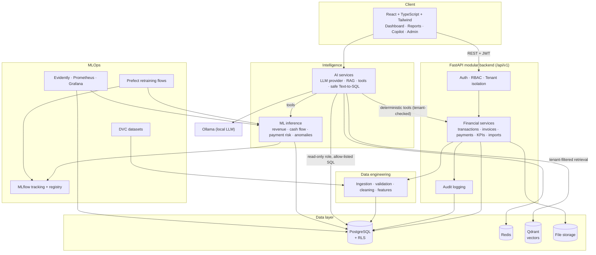

# FinSight AI — System Architecture

Modular backend first; separate inference / AI services only when they earn their keep.

## Communication rules
- The frontend never decides authorization; the backend derives `company_id` from verified membership.
- The LLM never computes financial figures. It selects **tools**; tools query PostgreSQL / call ML models.
- Predictions are advisory and stored with the model version that produced them.
- Only models that passed registry quality gates serve production traffic.
