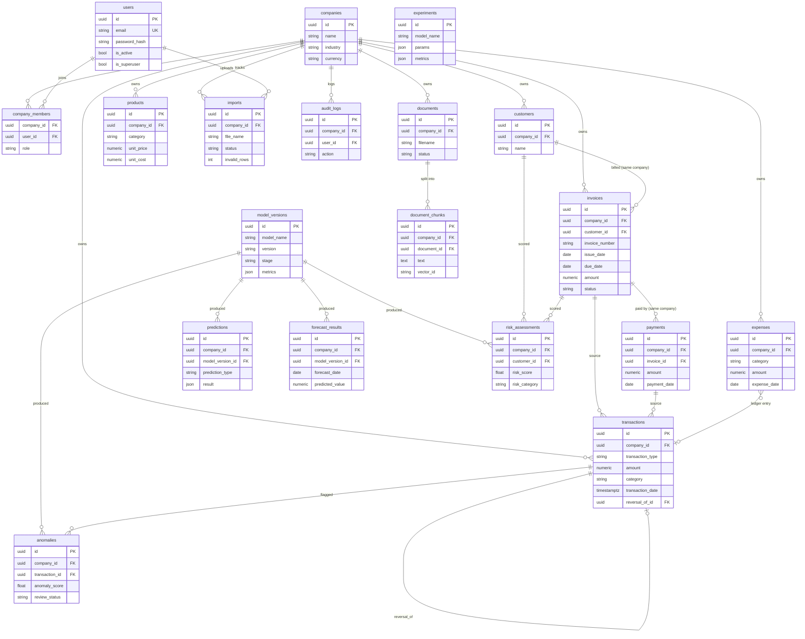

# FinSight AI — Database ERD (Milestone 1)

PostgreSQL, UUID primary keys, `NUMERIC(18,2)` money, `company_id` on every business table.
Tenant integrity is enforced **inside the database** with composite foreign keys, e.g.
`invoices(company_id, customer_id) → customers(company_id, id)`: an invoice cannot reference
another company's customer even if application code has a bug.

## Design decisions & known limits
- **Roles**: `super_admin` is platform-level (`users.is_superuser`); per-company roles live in `company_members.role` (`business_owner`, `finance_manager`, `financial_analyst`, `viewer`).
- **Transactions are a cash ledger, not double-entry accounting.** KPIs such as net profit must be labelled accordingly (Milestone 2). If full accounting is needed later: `accounts`, `journal_entries`, `journal_entry_lines`.
- **Soft delete / reversal**: `deleted_at` on financial records; `transactions.reversal_of_id` for reversals. No hard deletes of financial data.
- **Row-Level Security**: planned for Milestone 2 together with auth, because policies need the authenticated tenant (`SET app.current_company`). Composite FKs already protect cross-tenant references today.
- `model_versions` / `experiments` are platform-level; they hold metrics and metadata, never company rows.
- `anomalies.review_status` exists because an anomaly is a review candidate, not proof of fraud.
